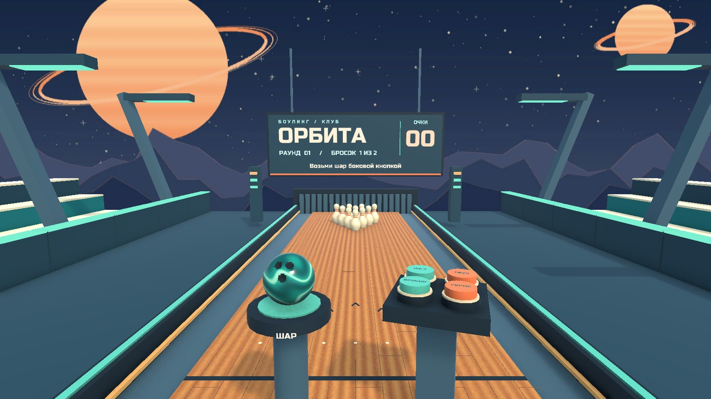

# Орбита · VR-боулинг

Готовое занятие по Unity для первого знакомства с VR. Игрок берёт шар с подсвеченной подставки, бросает его по дорожке и набирает очки. По умолчанию кегля стоит одно очко. За два броска или после полной расчистки дорожки начинается следующий раунд.

## Начать занятие

1. Открой проект в **Unity 6000.6.0f1** и сцену **Assets/Project/Scenes/VR_MK_1.unity**. При первом открытии дождись окончания импорта пакетов.
2. Для Quest 2 на ПК подключи шлем через **Steam Link** либо **Quest Link / Air Link**. Запусти **SteamVR** и убедись, что в окне SteamVR видны шлем и оба контроллера. В **SteamVR → Settings → OpenXR** выбери **Set SteamVR as OpenXR Runtime**, если активна другая среда. В Unity целевая платформа для этого способа подключения — **Windows**.
3. Встань лицом к дорожке. Если стойка с шаром оказалась сбоку или слишком далеко, отцентрируй положение в SteamVR. Нажми **Play** в Unity. Поднеси любую руку к шару, удерживай боковую кнопку контроллера, сделай бросок снизу и отпусти кнопку. Указательный палец реагирует на курок.
4. Без шлема нажми **Play**, щёлкни по окну **Game** и нажми **Пробел** для пробного броска. **R** начинает матч заново. Пульт справа в VR позволяет бросить демонстрационный шар, сбросить матч, сменить панораму и переключить музыку. Для кнопки поднеси контроллер или наведи луч и сожми рукоять.

## Как собрать свой уровень без кода

Выйди из **Play**. Открой **Мастерская → Орбита — набор деталей** и нажми **Создать свою копию уровня**. Окно можно закрепить рядом с **Scene**. Название детали перетаскивается мышью в сцену. Кнопка **+** сразу ставит деталь и выбирает её. Выбранный шар, кегля или кнопка показывают свои настройки сверху в окне мастерской. Те же поля есть в **Inspector**. Сохраняй результат через **Ctrl+S** до следующего запуска.

| Что попробовать | Что изменить |
|---|---|
| Собрать свой шар | Выбери «Комета», «Мандарин» или «Туманность». Кнопка **+** добавляет шар вместе с подставкой и назначает его для пробного броска. Для шара, перетащенного вручную, нажми **Выбрать для пробного броска**. Сравни массу, силу толчка и длину следа. |
| Поставить особую кеглю | Выбери «Маяк» или «Ракета», поставь на дорожку и задай ей пять очков. В поле **Когда упадёт → Что произойдёт** выбери **Текст и искры** и напиши короткое сообщение. |
| Построить расстановку | Работай в своей копии. Выбери существующую пирамиду **Rack** в Hierarchy и удали её. Добавь несколько кеглей, включи инструмент **Move** клавишей **W** и расставь их на поверхности дорожки. |
| Изменить вид станции | Нажми **+** у панорамы, чтобы переключить готовую станцию. Или выбери в Hierarchy объект **Decor**, укажи тему в Inspector и нажми **Показать в сцене**. |
| Сделать кнопку | Добавь **Своя надпись**, задай фразу и испытай кнопку в VR. Поле **При нажатии** переключает её между надписью, музыкой, темой, пробным броском и новым матчем. |
| Изменить правила | Выбери **★ ОРБИТА · мастерская**. Укажи число бросков в раунде, паузу после удара и громкость. |

**Пример на 75 минут.** Первые 10 минут — сыграть один раунд и найти шар, кегли и пульт в Hierarchy. Ещё 15 минут — сделать свою копию и сравнить два шара. Следующие 20 минут — построить расстановку и настроить призовую кеглю. За 15 минут выбрать панораму и придумать кнопку для другой команды. Последние 15 минут — обменяться уровнями, сыграть и рассказать, какое изменение сильнее всего повлияло на игру.

Готовые детали хранятся в **Assets/Project/Kit**. Русский шрифт Russo One распространяется по лицензии SIL OFL. [Текст лицензии](Assets/Project/Art/Type/OFL.txt)
