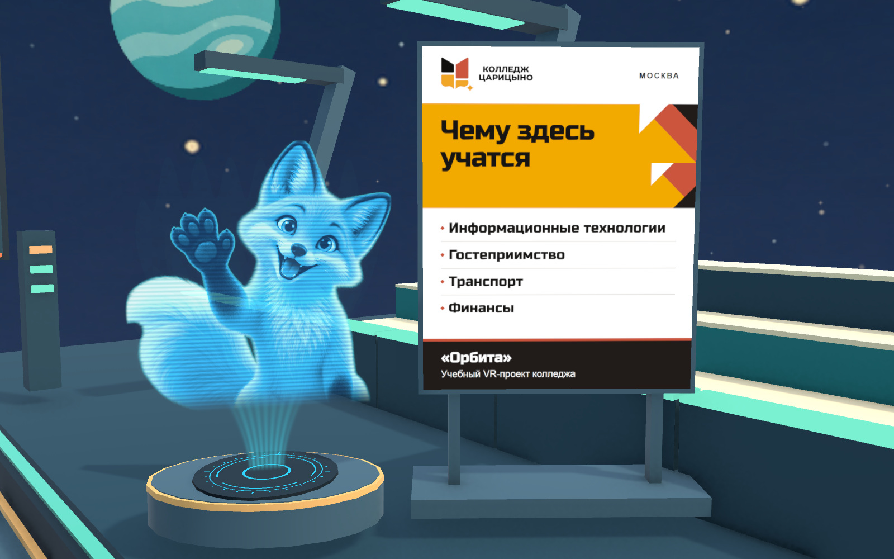
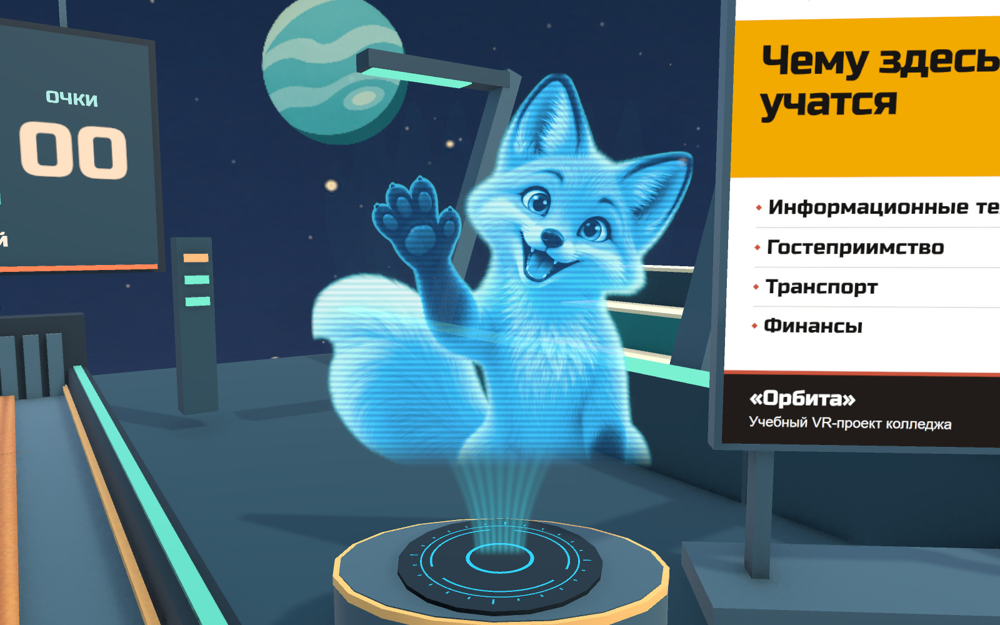

# «Орбита» · фирменный стиль колледжа «Царицыно»

У табло игроку нужны счёт и состояние броска. У бокового стенда он может задержаться, познакомиться с колледжем и рассмотреть маскота. Оба объекта закреплены в мире игры.

## Визуальные источники

| Материал из архива «ФИРМЕННЫЙ СТИЛЬ» | Применение в «Орбите» |
|---|---|
| `logo_svg/logo1.svg`, `tsaritsino_new_logo2.pdf` | Цветной горизонтальный знак с надписью на белой подложке. В макете используется готовая композиция целиком. Вектор сохранён в [College Logo.svg](College%20Logo.svg). |
| `colors.png` | Для крупных цветовых полей использованы подписанные в образце HEX: золотой `#F2A900` и терракотовый `#CB563D`. В исходном SVG у золота собственное значение `#F1A627`. |
| `post1/POST.png`, `post2/post2.png`, `post3/post3.png` | Светлое поле под логотип, контрастный заголовок и крупные геометрические фрагменты по краю. Треугольники собраны в правой части жёлтого поля, за пределами текста. |
| `МАСКОТ/mascot_hello.png` | Оригинальный прозрачный портрет с поднятой лапой. Шейдер переводит оттенки меха в голубой свет и сохраняет детали мордочки. |

## Главное табло

Цветная подпись колледжа занимает верхний левый угол. Белая подложка размером около 1,06 × 0,44 м содержит поля вокруг знака. Справа от неё начинается строка «Боулинг / клуб». Название «Орбита», номер броска и очки остаются самостоятельными строками. Верхний край корпуса поднят, чтобы освободить место под подпись.

При замене логотипа сохраняйте соотношение сторон исходного SVG и белые поля. После правки проверьте виды с начала дорожки и под углом. Длинное игровое сообщение должно помещаться под счётом.

## Стенд и маскот

Стенд стоит справа от дорожки, дальше пульта, и развёрнут к подходящему игроку. Вверху размещены знак колледжа и город, в центре — четыре направления подготовки, внизу — подпись «Учебный VR-проект колледжа». Названия направлений сверены с карточкой колледжа в городском атласе. [Атлас московских колледжей](https://colleges.shkolamoskva.ru/atlas/college/moskovskij-kolledzh-upravleniya-gostinichnogo-biznesa-i-informaczionnyh-tehnologij-czariczyno)

Для заголовка и списка используется игровой шрифт Russo One. Текст набран тёмным по белому и золотому. В нижней полосе используется белый по тёмному. Жёлтые и терракотовые элементы обозначают принадлежность колледжу. Счёт и действия игрока передаются словами и числами.

Слева от плаката проектор показывает лисичку с поднятой лапой. Тонкие голубые строки движутся по портрету, а от колец на подиуме к изображению поднимается полупрозрачный луч. При обходе стенда лисичка поворачивается к игроку вокруг вертикальной оси. В шлеме обе камеры видят одну плоскость, ориентированную по центру головы.

## Редактирование и проверка

- Чтобы изменить текст, откройте [макет плаката](College%20Banner.html). Экспортируйте его из браузера в PNG при размере области 1200 × 1500, масштабе 100% и плотности 1×. Замените `College Banner.png` в [папке оформления Unity](../../Assets/Project/Art/College/) с сохранением существующего файла `.meta`.
- Чтобы переместить стойку вместе с лисичкой, выберите **Стенд колледжа** в Hierarchy. Общие изменения для уровней вносятся в префаб **College Exhibit**. Материал плаката использует URP/Unlit и проверку глубины. Мип-карты и трилинейная фильтрация сглаживают текст при удалении.
- Изображение задаётся в поле **Mascot portrait** материала **Mascot Hologram**. Граф соединяет PNG и время с пользовательским узлом **Orbit → Projection → Mascot Hologram**. Узел рассчитывает цвет, прозрачность, контур, строки и луч. При уменьшении размера лисички на экране контраст строк снижается. [Шейдерный граф](../../Assets/Project/Art/College/Mascot%20Hologram.shadergraph) · [Код узла](../../Assets/Project/Art/College/OrbitHologram.hlsl)
- В Play Mode посмотрите на табло с точки броска, затем подойдите к стенду. Корпус и предметы перед табличками должны перекрывать рисунок в обоих глазах. Проверьте, что после броска счёт обновляется, а подиум и опоры находятся за пределами дорожки.
